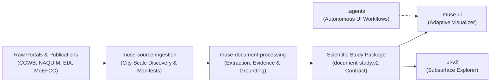

# Subsurface India — Agentic Subsurface Intelligence & Exploration

Subsurface India is an open-source, agentic research and visualization platform designed to unlock decades of geological, groundwater, and environmental impact assessments locked inside complex technical reports.

By pairing autonomous agentic extraction workflows with capability-negotiated 2D geospatial and 3D subsurface spatial visualization, Subsurface turns unstructured scientific literature into an interactive, rigorously grounded exploration experience.

---

## 🏛 System Architecture & Pipeline Flow

The platform is structured into five core, decoupled modules operating along a continuous evidence pipeline:



1. **Source Discovery (`muse-source-ingestion`)**: Resolves municipal/regional bounds, inventories local holdings, searches public government portals, audits candidate relevance, and compiles a validated source manifest.
2. **Document Extraction & Grounding (`muse-document-processing`)**: Ingests multimodal documents (PDFs, tables, maps, annexures), extracts measurements and coordinates, validates citations, and compiles structured study packages (`document-study.v2`).
3. **Adaptive Visual Agents (`.agents`)**: Autonomous workflows (`bootstrap`, `experience-foundation`, `evolve`, `refine`, `guardian`) driven by dual-agent roles (`Spark` for authoring, `Wonder` for critique) to evolve rendering capabilities safely.
4. **Adaptive Visualization Engine (`muse-ui`)**: Clean-room, capability-negotiated application shell that dynamically adapts visual layouts (2D map, 3D viewport, narrative panels) to match dataset features.
5. **Production Subsurface Explorer (`ui-v2`)**: Full-featured React 19 + MapLibre GL + React Three Fiber application providing dual-engine spatial exploration, executive dossiers, study catalog switching, and multi-layered evidence inspection.

---

## 📂 Core Modules Overview

| Module | Description | Key Tech Stack |
|---|---|---|
| **[`subsurface/.agents`](.agents/)** | Autonomous agentic workflow definitions, regression sentinels, and skill specs. | Node.js, Muse Agent Runtime |
| **[`subsurface/muse-source-ingestion`](muse-source-ingestion/)** | Automated city-scale source discovery, document acquisition, and manifest creation. | Node.js, Multi-Agent Orchestration |
| **[`subsurface/muse-document-processing`](muse-document-processing/)** | Deep multimodal extraction, table parsing, evidence inventory, and study packaging. | Node.js, Multimodal LLM Extraction |
| **[`subsurface/muse-ui`](muse-ui/)** | Adaptive scientific visualization engine with real-time capability negotiation. | React, TypeScript, MapLibre GL, Three.js, Vitest, Playwright |
| **[`subsurface/ui-v2`](ui-v2/)** | Next-generation Subsurface Explorer with dual 2D/3D canvas, HUD, and executive dossier. | React 19, Vite, Tailwind CSS v4, MapLibre GL, Three.js, R3F |

---

## 🚀 Quick Start

### Prerequisites
- **Node.js**: `v20.0.0` or higher
- **npm**: `v10.0.0` or higher
- A modern WebGL2-compatible browser (Chrome, Edge, Firefox, Safari)

### 1. Launching the Subsurface Explorer (`ui-v2`)

The primary application interface lives in `ui-v2`. It comes pre-loaded with curated study packages (e.g., *Bengaluru Groundwater Outlook 2025* and *BMRCL Phase 3 EIA*):

```bash
# Navigate to the UI v2 directory
cd ui-v2

# Install dependencies
npm install

# Start the local development server
npm run dev
```

Open `http://localhost:5173` in your browser.

- Switch studies using the study selector in the header.
- Toggle between **2D Map**, **3D Subsurface**, and **Split View** in the bottom HUD.
- Open the **Executive Dossier** to read plain-language summaries backed by page-level citations.
- Click any borehole, observation well, or corridor to inspect its depth log and stratigraphic profiles.

### 2. Launching the Adaptive Visualizer (`muse-ui`)

To inspect or evolve the clean-room adaptive visualization framework:

```bash
cd muse-ui
npm install
npm run dev
```

Run test suites and browser verification:
```bash
npm test            # Run unit test suite (Vitest)
npx playwright test # Run headless browser acceptance tests
```

### 3. Running Extraction & Ingestion Tests

Both processing modules contain self-verifying test suites with fixture-backed offline mocks:

```bash
# Run document processing pipeline tests
node muse-document-processing/tests/study-workflow.test.js

# Run source ingestion spill & distillation tests
node muse-source-ingestion/tests/ingest-workflow.test.js
```

---

## 📊 Scientific Data Contracts

The pipeline communicates using documented, schema-validated contracts:

- **`manifest.json` (`SourceManifest`)**: Output of source ingestion; lists acquired sources, SHA-256 hashes, temporal coverage, publisher metadata, and extraction readiness.
- **`study_package.json` (`document-study.v2`)**: Output of document processing; combines:
  - `rendering_package.json`: Spatial coordinates, depth intervals, lithological units, water quality samples.
  - `narrative_package.json`: Lay-accessible explanations, headline indicators, and entity cards.
  - `report.json`: Whole-study executive synthesis and risk analysis.
  - `evidence_inventory.json`: Page- and cell-level source grounding links.
- **`capability-registry.json`**: UI contract declaring which visual primitives (point observations, cross-sections, 3D lithological columns, isoline contours) are supported and negotiated.

---

## 🛡 Scientific Integrity & Clean-Room Principles

1. **Zero Hallucination / Strictly Grounded**: No coordinates, depths, water levels, or lithological classifications are synthesized without explicit primary evidence in source documents.
2. **Explicit Confidence Tiers**: Every measurement is tagged as `measured` (direct sensor/borehole reading), `interpreted` (geostatistical interpolation or model output), or `reported`.
3. **Honest Fallbacks**: If a study lacks 3D spatial points, the application degrades gracefully to map layers, tables, and narrative summaries without throwing runtime errors or rendering inaccurate mock shapes.
4. **Reproducibility**: Source documents are cached, checksummed (SHA-256), and linked by exact page, table, and paragraph references.

---

## 🤝 Contributing

We welcome contributions from hydrogeologists, software engineers, and data scientists! Please review our [Contributing Guidelines](CONTRIBUTING.md) and [Code of Conduct](CODE_OF_CONDUCT.md) before opening pull requests.

---

## 📄 License

This project is licensed under the [Apache License 2.0](LICENSE).
