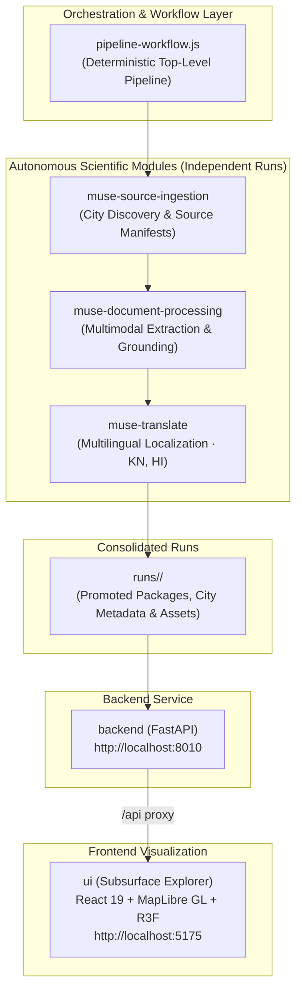

# Subsurface India (Upamelm.ai) — Agentic Subsurface Intelligence & Exploration

Subsurface India (Upamelm.ai) is an open-source, agentic research and visualization platform designed to unlock decades of geological, groundwater, and environmental impact assessments locked inside complex technical reports.

By pairing autonomous agentic discovery, multimodal document extraction, and multilingual translation with capability-negotiated 2D geospatial and 3D subsurface spatial visualization, the platform turns unstructured scientific literature into an interactive, rigorously grounded exploration experience.

> 📖 **Looking for comprehensive installation and execution guides? See [SETUP.md](SETUP.md).**

---

## 🏛 System Architecture & End-to-End Pipeline



---

## 📂 Core Modules & Workspaces

Every module can run **either as part of the unified pipeline or completely independently**:

| Module | Description | Port / Path | Tech Stack |
|---|---|---|---|
| **[`pipeline-workflow.js`](pipeline-workflow.js)** | Top-level orchestrator chaining ingestion, study fan-out, translation, and UI promotion. | Root | Node.js, Meta Muse |
| **[`backend/`](backend/)** | Read-only FastAPI service discovering cities, studies, and assets from `runs/`. | `http://localhost:8010` | Python 3.10+, FastAPI, Uvicorn |
| **[`ui/`](ui/)** | Flagship interactive Subsurface Explorer (2D map + 3D spatial scene + executive dossier). | `http://localhost:5175` | React 19, Vite, Tailwind v4, MapLibre GL, Three.js |
| **[`muse-source-ingestion/`](muse-source-ingestion/)** | Municipal-scale discovery and document acquisition from public portals (CGWB, NAQUIM). | Module | Node.js, Multi-Agent Discovery |
| **[`muse-document-processing/`](muse-document-processing/)** | Multimodal PDF/tabular extraction, evidence inventory, and `document-study.v2` packaging. | Module | Node.js, Multimodal Extraction |
| **[`muse-translate/`](muse-translate/)** | Multilingual localization (Kannada, Hindi, etc.) preserving exact scientific grounding. | Module | Node.js, Parallel LLM Lanes |
| **[`.agents/`](.agents/)** | Reusable agent skills, workflows, and health regression sentinels (`guardian`). | Module | Node.js, Muse Agent Runtime |

---

## 🚀 3-Minute Quickstart (Run Full App Today)

Experience the live application right now using the pre-promoted Bengaluru hydrogeological dataset:

### 1. Launch the Backend API
```bash
# In repository root
./backend/run.sh
```
The API initializes its virtual environment and starts on **`http://localhost:8010`** (Swagger docs: `http://localhost:8010/docs`).

### 2. Launch the Subsurface Explorer (`ui`)
In a new terminal:
```bash
cd ui
npm ci
npm run dev
```
Open **`http://localhost:5175`** in your browser.
- Seamlessly switch between **2D Map**, **3D Subsurface**, and **Split View**.
- Hot-switch languages: **English**, **Kannada (ಕನ್ನಡ)**, and **Hindi (हिन्दी)**.
- Hot-switch studies using the header dropdown.
- Click any borehole or transit corridor to view depth logs and page-level citations.

---

## 🔄 Running the End-to-End Orchestrated Pipeline

To run the complete automated pipeline from city discovery to translated, UI-ready packages:

```bash
# 1. Build the standalone bundle for the Muse runtime
node scripts/build-pipeline-workflow-runtime.mjs

# 2. Verify orchestration logic and test fixtures
node tests/pipeline-workflow.test.js
```

In Meta Muse or via `muse exec`:
```text
Use a workflow with the saved script pipeline-workflow.runtime.js with request="pipeline-requests/bengaluru.json".
```

---

## 🧩 Running Individual Modules Independently

Every module operates as an independent, test-backed unit:

- **Source Ingestion**:
  ```bash
  node muse-source-ingestion/tests/ingest-workflow.test.js
  # In Muse: Run muse-source-ingestion/ingest-workflow.js with request="muse-source-ingestion/requests/bengaluru.json"
  ```
- **Document Processing**:
  ```bash
  node muse-document-processing/tests/study-workflow.test.js
  # In Muse: Run a subsurface study on playground/bangalore_aquifier.pdf
  ```
- **Multilingual Translation**:
  ```bash
  node muse-translate/tests/translate-workflow.test.js
  # In Muse: Run muse-translate/translate-workflow.js with input="muse-document-processing/runs/<run>" languages=["Kannada", "Hindi"]
  ```
- **Backend**:
  ```bash
  cd backend
  python3 -m venv .venv
  .venv/bin/python -m pip install -e '.[test]'
  .venv/bin/python -m pytest
  ```
- **UI Frontend**:
  ```bash
  cd ui && npm run verify
  ```
---

## 📊 Scientific Data Contracts

- **`manifest.json` (`SourceManifest`)**: Output of source ingestion; lists acquired sources, SHA-256 hashes, temporal coverage, publisher metadata, and extraction readiness.
- **`study_package.json` (`document-study.v2`)**: Output of document processing; combines:
  - `rendering_package.json`: Spatial coordinates, depth intervals, lithological units, water quality samples.
  - `narrative_package.json`: Lay-accessible explanations, headline indicators, and entity cards.
  - `report.json`: Whole-study executive synthesis and risk analysis.
  - `evidence_inventory.json`: Page- and cell-level source grounding links.
- **`study_package_<lang>.json`**: Output of translation; exact schema mirror with localized plain-language prose and identical IDs, coordinates, and units.
- **`city.json` (`city-catalog.v1`)**: Discovered municipal catalog entry for geographic spatial indexing.

---

## 🛡 Scientific Integrity & Clean-Room Principles

1. **Zero Hallucination / Strictly Grounded**: No coordinates, depths, water levels, or lithological classifications are synthesized without explicit primary evidence in source documents.
2. **Explicit Confidence Tiers**: Every measurement is tagged as `measured` (direct sensor/borehole reading), `interpreted` (geostatistical interpolation or model output), or `reported`.
3. **Honest Fallbacks**: If a study lacks 3D spatial points, the application degrades gracefully to map layers, tables, and narrative summaries without throwing runtime errors or rendering inaccurate mock shapes.
4. **Reproducibility**: Source documents are cached, checksummed (SHA-256), and linked by exact page, table, and paragraph references.

---

## 🤝 Contributing & Community

Please review our [Contributing Guidelines](CONTRIBUTING.md) and [Code of Conduct](CODE_OF_CONDUCT.md) before submitting pull requests.

---

## 📄 License

This project is licensed under the [Apache License 2.0](LICENSE).
