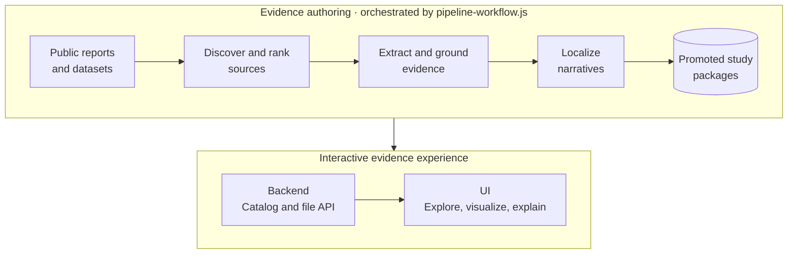

# Upamelm.ai — Maps show the world. We help you understand what's underneath.

Upamelm.ai is an open-source, AI-powered multi-agent platform that transforms complex, unstructured information into interactive, explorable 2D and 3D spatial experiences.

Its end-to-end architecture combines autonomous source discovery, document intelligence, multilingual translation, and adaptive visualization. Rather than assuming one report format, city, or knowledge domain, Upamelm.ai derives evidence-backed spatial experiences from the information that is actually available. The included Bengaluru subsurface studies are a reference implementation of this broader architecture.

**Any city. Any domain. Any document. A world of knowledge waiting to be explored.**

> 📖 **Looking for comprehensive installation and execution guides? See [SETUP.md](SETUP.md).**

---

## 🏛 How the System Works

Upamelm.ai has two connected paths: an **evidence-authoring pipeline** turns
public reports and datasets into grounded study packages, and the **interactive
application** turns those packages into an explorable, multilingual evidence
experience.



- **Authoring path:** `pipeline-workflow.js` coordinates source discovery,
  per-document extraction and grounding, multilingual localization, and
  promotion into self-contained city and study packages under `runs/`.
- **Runtime path:** `backend/` discovers the promoted packages directly from
  disk and exposes their catalogs, study contracts, translations, and assets.
- **User experience:** `ui/` provides city, study, and language selection;
  coordinated 2D and 3D exploration; charts and structured evidence; plain-
  language feature explanations; source citations; and whole-study reports.

### Muse-powered agent architecture

Muse Code is used as the orchestration harness for the platform's independent
agents—not only as a coding assistant. The workflow spans three connected
stages:

1. **Autonomous discovery:** research agents investigate a location, identify
   relevant sources, assess their value, and ingest useful documents and data.
2. **Document intelligence:** specialized agents plan extraction strategies,
   analyze complex formats, identify spatial relationships, cross-reference
   findings, and synthesize structured knowledge with traceable evidence.
3. **Adaptive visualization:** agents translate the synthesized knowledge into
   visualization-ready specifications, interactive geographic layers, 3D
   representations, and UI components suited to the capabilities of each
   study package.

The Muse workflows use a multi-model contributor/reviewer pattern: Spark acts
as the workhorse for high-volume execution, while Wonder handles planning,
review, and deeper synthesis. Translation workflows make technical findings
accessible in multiple languages, and the adaptive visualization harness can
inspect and evolve both UI and supporting backend flows. Persistent lesson
artifacts help later runs reuse successful patterns and avoid known failures.

## 📂 Modules & Workspaces

Every module can run **either as part of the unified pipeline or completely independently**:

| Module | Description | Port / Path | Tech Stack |
|---|---|---|---|
| **[`pipeline-workflow.js`](pipeline-workflow.js)** | Top-level orchestrator chaining ingestion, study fan-out, translation, and UI promotion. | Root | Node.js, Meta Muse |
| **[`backend/`](backend/)** | Read-only catalog and file API that discovers cities, studies, translations, and assets from `runs/`. | `http://localhost:8010` | Python 3.10+, FastAPI, Uvicorn |
| **[`ui/`](ui/)** | Interactive evidence explorer combining discovery, multilingual selection, 2D/3D visualization, charts, grounded explanations, citations, and study reports. | `http://localhost:5175` | React 19, Vite, Tailwind v4, MapLibre GL, Three.js |
| **[`muse-source-ingestion/`](muse-source-ingestion/)** | Municipal-scale discovery and document acquisition from public portals (CGWB, NAQUIM). | Module | Node.js, Multi-Agent Discovery |
| **[`muse-document-processing/`](muse-document-processing/)** | Multimodal PDF/tabular extraction, evidence inventory, and `document-study.v2` packaging. | Module | Node.js, Multimodal Extraction |
| **[`muse-translate/`](muse-translate/)** | Multilingual localization (Kannada, Hindi, etc.) preserving exact scientific grounding. | Module | Node.js, Parallel LLM Lanes |
| **[`.agents/`](.agents/)** | Reusable agent skills, workflows, and health regression sentinels (`guardian`). | Module | Node.js, Muse Agent Runtime |

---

## 🚀 3-Minute Quickstart (Run Full App Today)

Experience the live application right now using the pre-promoted Bengaluru hydrogeological dataset:

### 1. Launch the Backend API
```bash
# In repository root
./backend/run.sh
```
The API initializes its virtual environment and starts on **`http://localhost:8010`** (Swagger docs: `http://localhost:8010/docs`).

### 2. Launch the Upamelm.ai Explorer (`ui`)
In a new terminal:
```bash
cd ui
npm ci
npm run dev
```
Open **`http://localhost:5175`** in your browser.
- Seamlessly switch between **2D Map**, **3D Subsurface**, and **Split View**.
- Hot-switch languages: **English**, **Kannada (ಕನ್ನಡ)**, and **Hindi (हिन्दी)**.
- Hot-switch studies using the header dropdown.
- Click any borehole or transit corridor to view depth logs and page-level citations.

---

## 🔄 Running the End-to-End Orchestrated Pipeline

To run the complete automated pipeline from city discovery to translated, UI-ready packages:

```bash
# 1. Build the standalone bundle for the Muse runtime
node scripts/build-pipeline-workflow-runtime.mjs

# 2. Verify orchestration logic and test fixtures
node tests/pipeline-workflow.test.js
```

In Meta Muse or via `muse exec`:
```text
Use a workflow with the saved script pipeline-workflow.runtime.js with request="pipeline-requests/bengaluru.json".
```

---

## 🧩 Running Individual Modules Independently

Every module operates as an independent, test-backed unit:

- **Source Ingestion**:
  ```bash
  node muse-source-ingestion/tests/ingest-workflow.test.js
  # In Muse: Run muse-source-ingestion/ingest-workflow.js with request="muse-source-ingestion/requests/bengaluru.json"
  ```
- **Document Processing**:
  ```bash
  node muse-document-processing/tests/study-workflow.test.js
  # In Muse: Run a subsurface study on playground/bangalore_aquifier.pdf
  ```
- **Multilingual Translation**:
  ```bash
  node muse-translate/tests/translate-workflow.test.js
  # In Muse: Run muse-translate/translate-workflow.js with input="muse-document-processing/runs/<run>" languages=["Kannada", "Hindi"]
  ```
- **Backend**:
  ```bash
  cd backend
  python3 -m venv .venv
  .venv/bin/python -m pip install -e '.[test]'
  .venv/bin/python -m pytest
  ```
- **UI Frontend**:
  ```bash
  cd ui && npm run verify
  ```
---

## 📊 Scientific Data Contracts

- **`manifest.json` (`SourceManifest`)**: Output of source ingestion; lists acquired sources, SHA-256 hashes, temporal coverage, publisher metadata, and extraction readiness.
- **`study_package.json` (`document-study.v2`)**: Output of document processing; combines:
  - `rendering_package.json`: Spatial coordinates, depth intervals, lithological units, water quality samples.
  - `narrative_package.json`: Lay-accessible explanations, headline indicators, and entity cards.
  - `report.json`: Whole-study executive synthesis and risk analysis.
  - `evidence_inventory.json`: Page- and cell-level source grounding links.
- **`study_package_<lang>.json`**: Output of translation; exact schema mirror with localized plain-language prose and identical IDs, coordinates, and units.
- **`city.json` (`city-catalog.v1`)**: Discovered municipal catalog entry for geographic spatial indexing.

---

## 🛡 Scientific Integrity & Clean-Room Principles

1. **Zero Hallucination / Strictly Grounded**: No coordinates, depths, water levels, or lithological classifications are synthesized without explicit primary evidence in source documents.
2. **Explicit Confidence Tiers**: Every measurement is tagged as `measured` (direct sensor/borehole reading), `interpreted` (geostatistical interpolation or model output), or `reported`.
3. **Honest Fallbacks**: If a study lacks 3D spatial points, the application degrades gracefully to map layers, tables, and narrative summaries without throwing runtime errors or rendering inaccurate mock shapes.
4. **Reproducibility**: Source documents are cached, checksummed (SHA-256), and linked by exact page, table, and paragraph references.

---

## 🤝 Contributing & Community

Please review our [Contributing Guidelines](CONTRIBUTING.md) and [Code of Conduct](CODE_OF_CONDUCT.md) before submitting pull requests.

---

## 📄 License

This project is licensed under the [Apache License 2.0](LICENSE).
