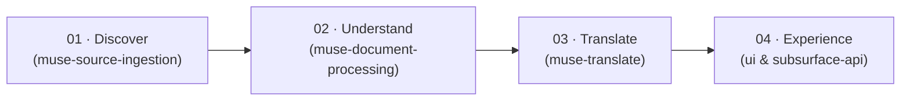
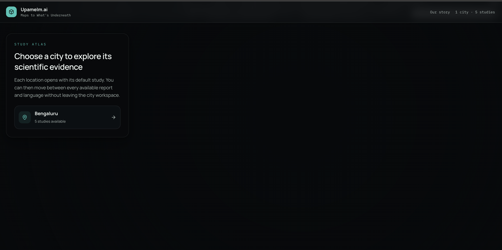
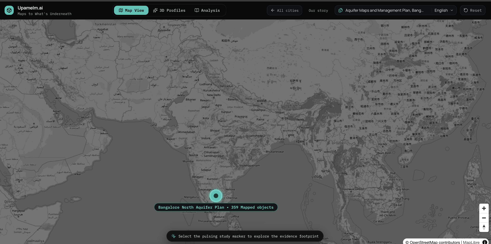
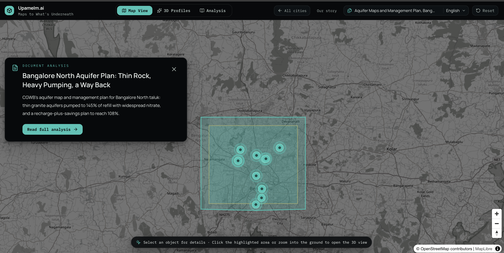
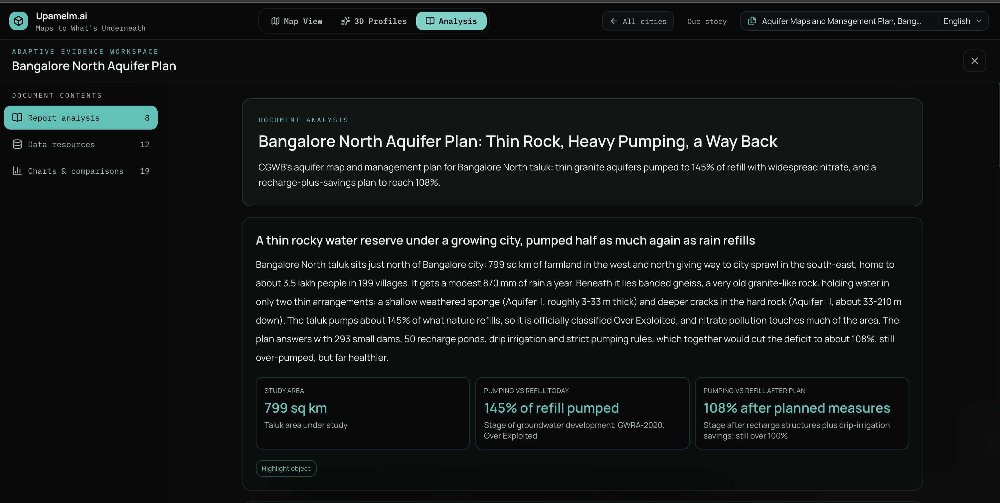
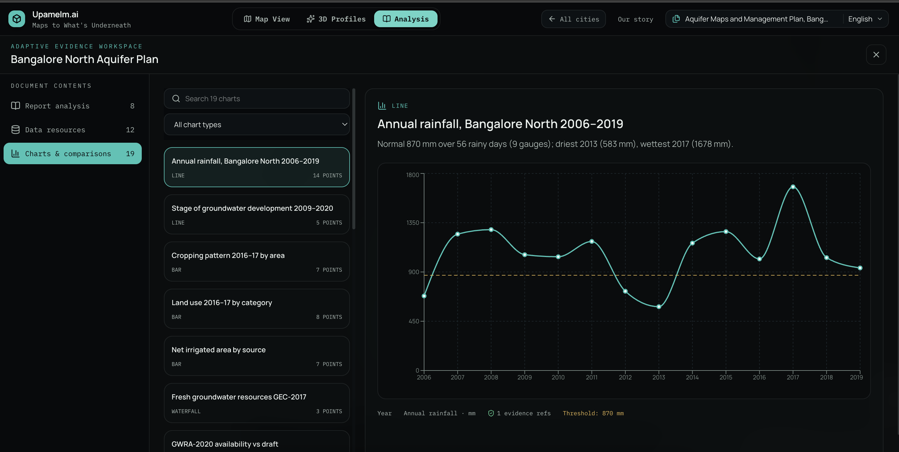
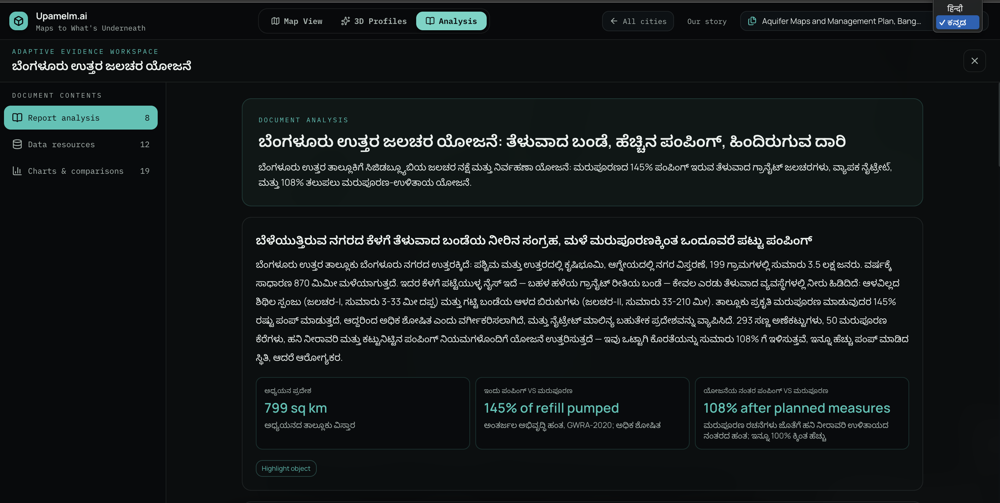
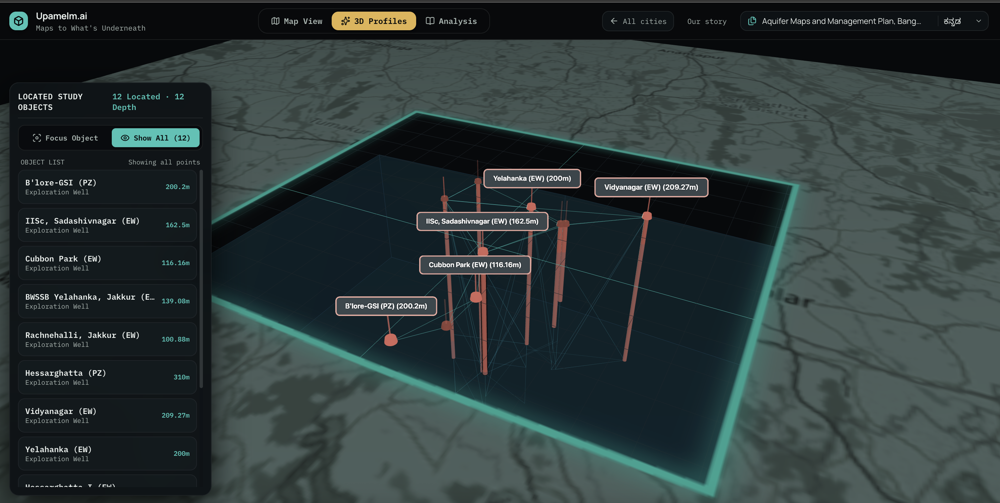
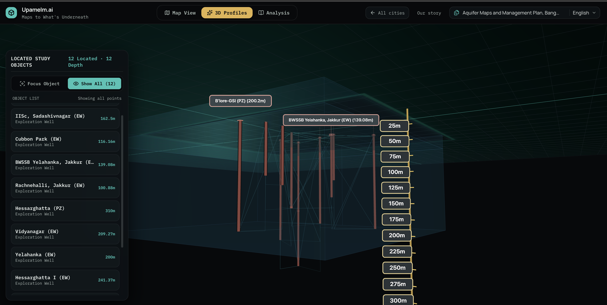
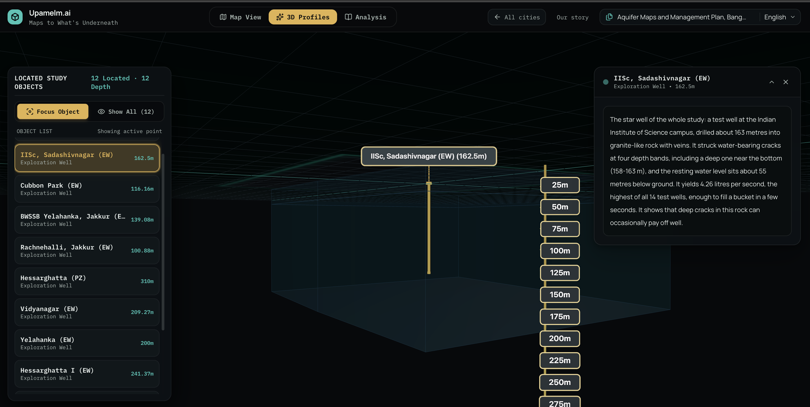

# Upamelm.ai · Our Story

> **"Maps show the surface. We reveal what lies beneath."**  
> *An AI-powered scientific exploration platform for making the invisible systems beneath our cities understandable—and traceable to evidence.*
>
> 📄 **[View / Download Presentation PDF](our-story-upamelm-ai.pdf)** · 🚀 **[Quickstart Setup Guide](../SETUP.md)** · 🏛 **[System Architecture](../README.md)**

---

## 🌍 The Overlooked Half of Our World

A city does not end at the asphalt. It continues dozens, hundreds of meters below the street.

Beneath every road, foundation, and metro line lies a hidden world:
- **Groundwater** that supplies homes, borewells, and industries.
- **Aquifers** in weathered rock and fractured granite that store and transmit water.
- **Lithological strata** that dictate where infrastructure can be built and where recharge is possible.

These subterranean systems shape everyday life, urban resilience, and drought vulnerability—**even though we almost never see them**.

---

## 🔍 The Problem: The Knowledge Exists, But Access is Broken

Government agencies and scientific institutions have spent decades drilling boreholes, testing water quality, and publishing rigorous hydrogeological surveys. In India alone, organizations like the **Central Ground Water Board (CGWB)** and **State Ground Water Departments** have produced thousands of exhaustive reports.

Yet, this wealth of knowledge remains trapped:
- Locked inside **200-page technical PDFs**, dense annexures, and specialist tables.
- Disconnected from the real physical places people live and work.
- Inaccessible to urban planners, civil engineers, journalists, and citizens who ask:
  > *"What does a 200-page aquifer report mean for **my city, my neighborhood, my water?**"*

---

## ⚖️ Our Three Core Principles

Upamelm.ai was built on three foundational tenets:

1. **`01 · Place`**: Show scientific information where it belongs—anchored to real geospatial coordinates and depth-registered subterranean space.
2. **`02 · Meaning`**: Translate specialist jargon into clear, human-accessible narratives and plain language.
3. **`03 · Evidence`**: Keep every single observation, chart, and conclusion explicitly connected to its original primary source citation. **Zero hallucination.**

---

## 🤖 The Meta Muse Agentic Pipeline

Rather than building a brittle, hardcoded scraper, Upamelm.ai uses an autonomous multi-agent architecture built with **Meta Muse Code**:

1. **Discover (`muse-source-ingestion`)**: Region-aware research agents investigate a given city, discover relevant sources across public repositories, evaluate relevance, download validated files, and compile a checksummed manifest.
2. **Understand (`muse-document-processing`)**: Specialized extraction agents parse multimodal documents (PDFs, tables, maps, figures), extract measurements, correlate depths, and compile a structured `document-study.v2` package.
3. **Translate (`muse-translate`)**: Language agents generate plain-language, multilingual versions of the package (e.g. Kannada, Hindi) while preserving every ID, coordinate, unit, and citation exactly.
4. **Experience (`ui` / `subsurface-api`)**: Capability-negotiated rendering transforms the synthesized package into an interactive 2D GIS map, 3D subsurface scene, and executive dossier.

---

## 📸 End-to-End Visual Tour of Upamelm.ai

Follow along as we walk through the live product experience:

### Step 1: Regional Landing & City Discovery
Exploration begins at the subcontinent level, discovering municipal holdings, studies, and spatial centroids.

---

### Step 2: Bird's-Eye Regional GIS View
A broad, macro-level geospatial view provides immediate context on study boundaries, observation networks, and regional topography.

---

### Step 3: Close-Up City GIS Exploration
Zooming into Bengaluru reveals municipal wards, taluks, monitoring well networks, and dynamic layer controls.

---

### Step 4: Evidence-Grounded Executive Dossier
The slide-out Executive Dossier translates hundreds of pages of technical findings into clear, lay-accessible prose with direct page-level citations.

---

### Step 5: Quantitative Analytics & Chart Workspaces
Dynamic charting workspaces plot seasonal water-level trends, pre/post-monsoon fluctuations, and decadal drawdown curves.

---

### Step 6: Multilingual Accessibility (Kannada / ಕನ್ನಡ)
Full multilingual localization ensures local communities can access scientific insights in their native tongue without loss of scientific precision.

---

### Step 7: 3D Subsurface Exploration — Top-Down Perspective
Transition seamlessly from 2D geography into a 3D WebGL spatial twin showing surface topography and borehole collars.

---

### Step 8: Deep Subterranean View — Lithological Slabs & Well Network
Rotate underground to reveal 3D geological formations, weathered zones, and fractured crystalline basement rock.

---

### Step 9: Single-Borehole High-Fidelity Inspection
Inspect individual borehole columns with exact depth intervals (mbgl), lithological classifications, and piezometric water table levels.

---

## 🛡 Scientific Guardrails & Honesty

- **Measured vs. Derived vs. Illustrative**:
  - `Measured`: Direct sensor readings, borehole drilling logs, and lab chemical tests.
  - `Derived`: Geostatistical interpolations, water balances, and recharge calculations.
  - `Illustrative`: Visual spatial guides and reference boundaries.
- **No Hallucinated Geometries**: If a study does not report a depth or coordinate, **no underground geometry is invented**. The data is honestly presented in tabular and narrative views with an unlocated tag.

---

## 🚀 The Vision Ahead

Bengaluru is our working proof of concept. Over time, the same evidence-first, agentic approach will scale:
- **Across Cities**: Expanding to Delhi, Ahmedabad, Chennai, and metropolitan regions nationwide.
- **Across Domains**: Moving from groundwater and aquifers into soil mechanics, environmental impact assessments, seismic hazards, and underground transit corridors.

**Any city. Any domain. Any document. A hidden world waiting to be explored.**

---

*Built with Meta Muse Code for the Meta AI Developer Hackathon.*
