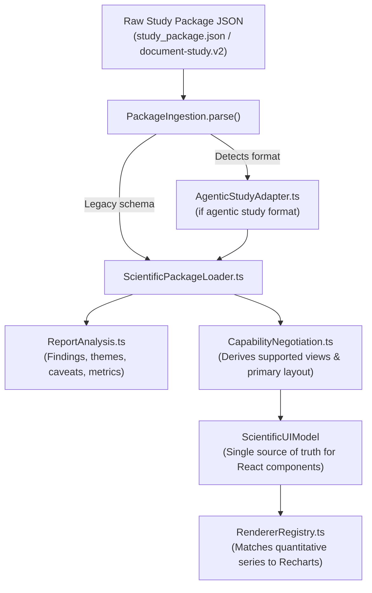

# UI Core Architecture & Data Engine (`ui/src/core`)

The `core` directory implements the data-ingestion pipeline, schema normalization adapters, capability negotiation engine, and renderer registries that power the Upamelm.ai UI.

---

## 🏛 Pipeline Flow & Responsibilities



---

## 📁 Module Inventory

| File | Primary Responsibility |
|---|---|
| **[`PackageIngestion.ts`](PackageIngestion.ts)** | Unified entry point. Auto-detects legacy vs. agentic study contracts and produces a single `ScientificUIModel`. |
| **[`AgenticStudyAdapter.ts`](AgenticStudyAdapter.ts)** | Normalizes `document-study.v2` and `study-rendering.v2` contracts produced by `muse-document-processing`. |
| **[`ScientificPackageLoader.ts`](ScientificPackageLoader.ts)** | Standardizes coordinates (DMS to decimal degrees), computes spatial hulls, resolves intervals into regional strata, and indexes features. |
| **[`UniversalPackageLoader.ts`](UniversalPackageLoader.ts)** | Converts arbitrary dimensional geometry and intervals into a 3D scene model (`UniversalSceneModel`). |
| **[`CapabilityNegotiation.ts`](CapabilityNegotiation.ts)** | Evaluates incoming evidence (points, lines, polygons, boreholes, time series, raster overlays) to negotiate layout modes and available workspaces. |
| **[`RendererRegistry.ts`](RendererRegistry.ts)** | Semantic registry of quantitative chart types (`line`, `bar`, `histogram`, `scatter`, `waterfall`, `kpi`). Matches series dynamically with fallbacks. |
| **[`ReportAnalysis.ts`](ReportAnalysis.ts)** | Indexes chapters, themes, findings, and statistical indicators for the Executive Dossier Drawer, validating referential integrity against spatial and borehole features. |

---

## 🧪 Testing & Verification

All core modules have unit and integration tests under `ui/`:
- `src/core/generic-rendering.test.ts`: Verifies capability negotiation and renderer selection.
- `real-packages.test.ts`: Verifies parsing of actual production packages (e.g. *Bengaluru Groundwater Outlook 2025* and *BMRCL Phase 3 EIA*).
- `bmrcl-tmp-adapter.test.ts`: Validates adapter backward compatibility.

Run all tests:
```bash
npm test
```
